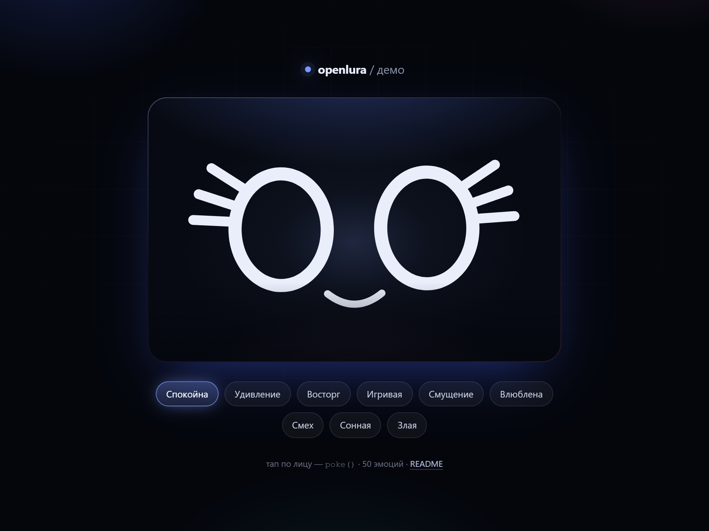

# openlura

Открытый движок лица Луры: одно лицо, 50 эмоций и лип-синк под русский текст. Чистый JS + SVG, без зависимостей и без сборки — скачал, открыл, делаешь что хочешь.



## Что внутри

- **Один файл.** `src/face.js` — 1674 строки, ноль импортов и ноль зависимостей. Работает в браузере как ES-модуль.
- **SVG-рендер.** Лицо собирается из SVG-элементов, поэтому масштабируется без потерь и красится через CSS.
- **50 эмоций** с плавными переходами на пружинной физике (`k`, `z` настраиваются на эмоцию).
- **Идл-анимация.** Дыхание, моргание со случайными интервалами, блуждающий взгляд, микро-наклоны.
- **Лип-синк по тексту.** `speak(text)` раскладывает русский текст на слоги и виземы (а/о/у/и), отдельно обрабатывает губные согласные (б, п, м, в, ф).
- **Частицы.** Сердца, звёзды, слёзы, пот, искры, «z-z», вены, ноты, пар — включаются эмоцией.
- **Реакции и жесты.** `react()`, `reactSeq()`, `poke()`, `boop()`, `tap()`, `wow()`, `ack()`, `shaken()`.
- **Режимы.** Обычный, `small` (компактный вьюбокс для виджетов), отключение частиц, `prefers-reduced-motion` уважается автоматически.

## Быстрый старт

Нужен любой статический сервер: ES-модули не грузятся с `file://`.

```bash
git clone https://github.com/openlura/openlura.git openlura
cd openlura
python -m http.server 8000
```

Открыть <http://localhost:8000/examples/index.html> — минимальное демо: лицо, чипы эмоций и тап по лицу.

Или подключить у себя:

```html
<link rel="stylesheet" href="./src/face.css">
<div id="stage" style="width: 520px; height: 340px"></div>

<script type="module">
  import { Face } from "./src/face.js";

  const face = new Face(document.getElementById("stage"));
  face.setEmotion("calm");
  face.speak("привет, это openlura");
</script>
```

Стили `src/face.css` обязательны: в них цвета SVG-градиентов ауры и румянца. Без них аура останется чёрной. Свои цвета — переменные `--glow` и `--blush` на контейнере.

Анимационный цикл запускается сам в конструкторе — `requestAnimationFrame` крутится внутри `Face`, ничего вызывать не нужно. Когда вкладка скрыта, цикл засыпает.

## API

Все методы ниже реально есть в `src/face.js`.

### Создание

```js
new Face(host, options)
```

| Опция | Тип | По умолчанию | Что делает |
|---|---|---|---|
| `small` | `boolean` | `false` | Компактный вьюбокс `88 118 824 430` — для маленьких виджетов |
| `particles` | `boolean` | `true` | Частицы; автоматически выключаются в `small` и при `prefers-reduced-motion` |
| `idle` | `boolean` | `false` | Включить идл-анимацию (дыхание, блуждающий взгляд) |
| `viewBox` | `string` | `0 0 1000 640` | Свой вьюбокс |

### Эмоции

```js
face.setEmotion("surprised");              // базовая эмоция, intensity 0.8
face.setEmotion("shy", { intensity: 1 });  // сильнее
face.react("wink", 1600, 0.9);             // эмоция на 1.6 с и возврат к базовой
face.reactSeq([["surprised", 900], ["laugh", 1500]]);  // очередь реакций
```

### Речь и слух

```js
face.speak("три тысячи подписчиков");  // лип-синк по тексту
face.listen(true);                     // режим «слушаю»
face.waitReply(true);                  // «жду ответа»
face.think(true);                      // «думаю»
```

### Взгляд и взаимодействие

```js
face.lookAt(0.5, 0.2);   // взгляд в точку вьюбокса, hold 1.2 с
face.poke();             // тычок
face.boop();             // «буп» по носу
face.tap({ x: 300, y: 200 });  // тап в координатах
face.attach(element);    // привязать к DOM-элементу (тапы по нему)
face.wow(); face.ack(); face.shaken();
```

### Режимы и управление

```js
face.setMode("night");   // режим отображения
face.setDayHour(17);     // тон под время суток
face.pause(); face.resume();
face.destroy();          // убрать SVG и отписаться от цикла
```

### Низкий уровень

```js
face.step(dt);           // один шаг симуляции, секунды
face.play("clipName");   // проиграть клип из CLIPS
```

## Эмоции (50)

```
calm, warm, happy, joy, playful, sarcastic, surprised, sad, worried, hurt,
irritated, angry, sleepy, sleeping, thinking, love, shy, excited, confused,
proud, scared, bored, curious, laugh, crying, wink, dizzy, focused,
listening, delighted, relieved, skeptical, mischievous, anticipates, tender,
inquisitive, daydream, reconciled, cozy, giggle, pout, determined, laughcry,
shocked, dreamy, sly, yum, oops, tired, party
```

Каждая эмоция — набор параметров: форма глаз и век (`et`, `eb`), рот (`mw`, `mct`, `mcb`), румянец, аура, ресницы, наклон, частицы, траектория взгляда.

## Лип-синк

`face.speak(text)` не требует аудио: он разбивает строку на слоги и проигрывает виземы по таймингу.

- Гласные: `а/я → a`, `о/ё → o`, `у/ю → u`, `и/ы/е/э → i`.
- Губные (`б, п, м, в, ф`) дают смыкание губ — рот закрывается на этих согласных.
- Поддерживается латиница.

## Кастомизация

- **Бантик.** В исходном проекте бантик — отдельный SVG-слой поверх лица (левый глаз), появляется по таймингу. В `openlura` его нет: это внешний декор, добавляй свой элемент и анимируй как хочешь.
- **Цвета и свечение** — через CSS-переменные на контейнере.
- **Частицы** отключаются опцией `particles: false`.

## Структура

```
openlura/
├── src/
│   ├── face.js          # движок, единственный обязательный JS
│   └── face.css         # градиенты ауры и румянца (обязательный CSS)
├── examples/
│   ├── index.html       # демо: чипы эмоций, лип-синк, реакции
├── NOTICE.md            
├── LICENSE              
└── README.md
```

## Лицензия

Код — MIT, делай что хочешь. См. [LICENSE](LICENSE).
